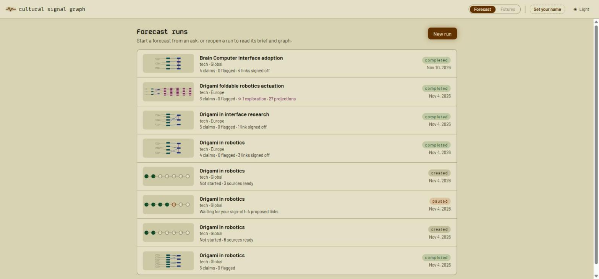
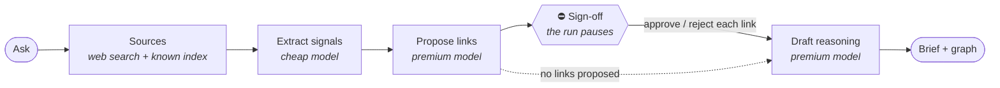
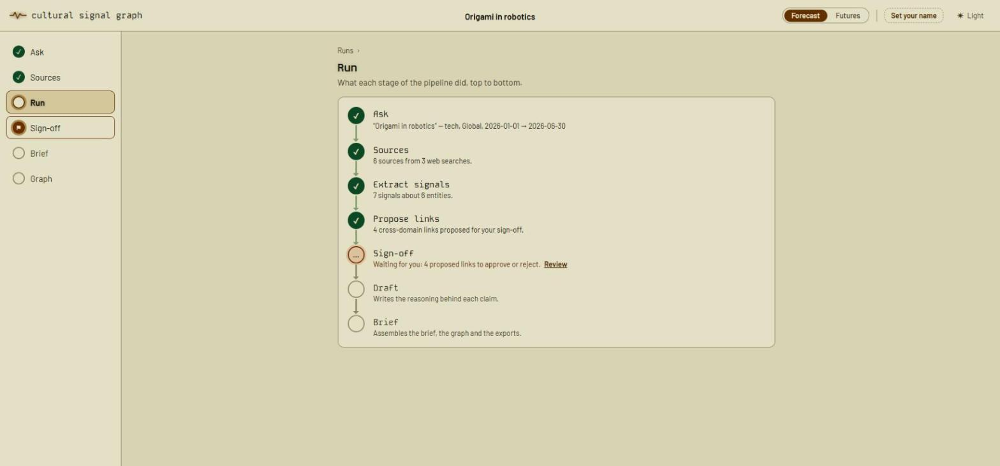
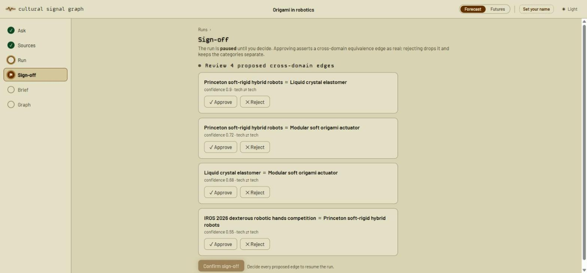
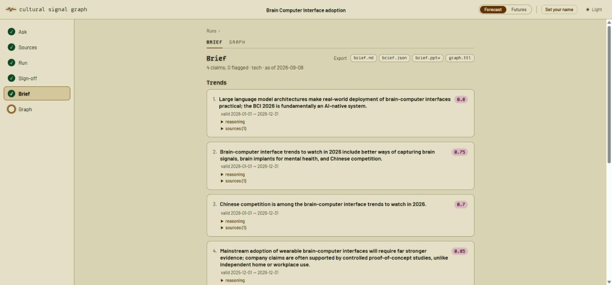
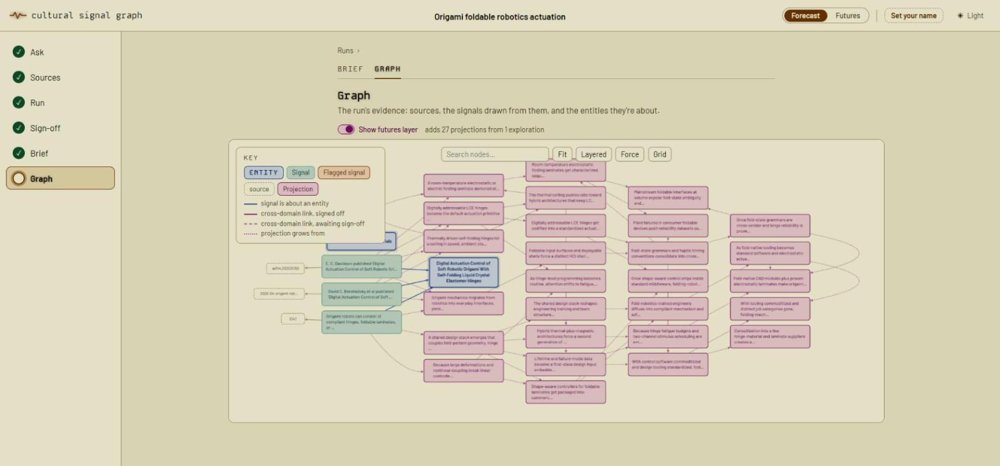
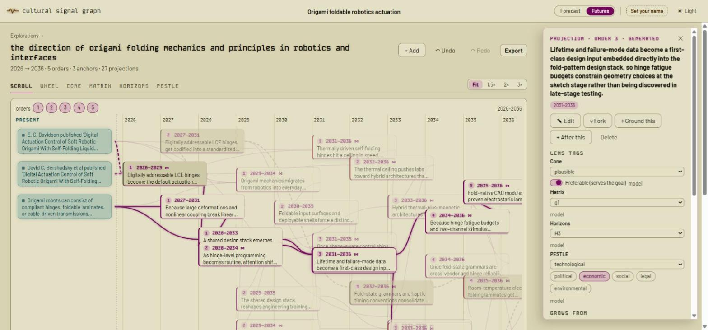
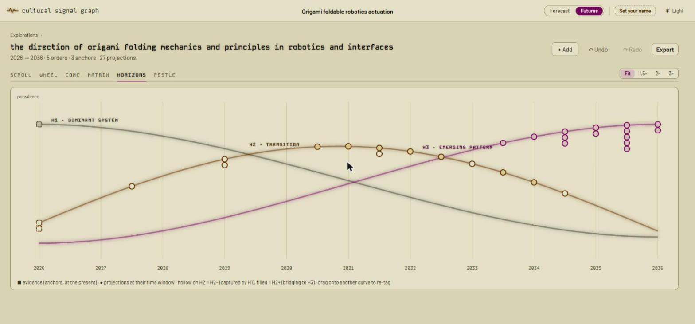
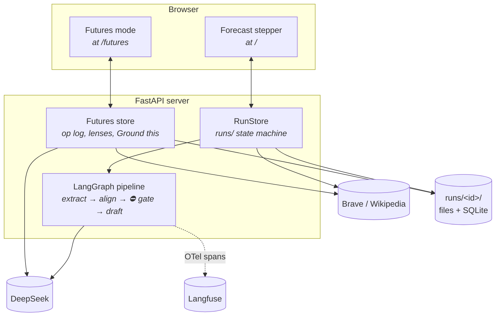
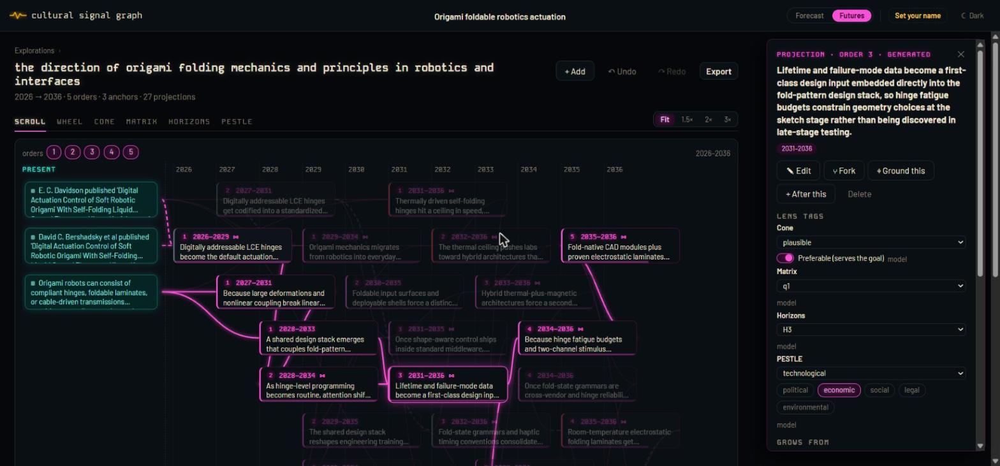

# Cultural Signal Graph

An agentic knowledge-graph system for cultural and trend forecasting whose output is
**auditable, provenance-bearing reasoning**, not a black-box prediction.

It gathers sources for a question, extracts entities and signals, links them into an RDF
graph whose edges carry **confidence, temporal validity and provenance**, and drafts a
**forecast brief** a strategist can trace back to its evidence. It never quietly averages
conflict away: contradictory and low-confidence signals are **flagged**, and cross-domain
links **stop for human sign-off**. From a finished forecast, **futures mode** grows
speculative explorations, kept apart from the evidence by design.



## Quick start

Requires Python 3.11+ and [`uv`](https://docs.astral.sh/uv/).

```bash
uv sync                      # install dependencies

cp .env.example .env         # then set DEEPSEEK_API_KEY=sk-...  (auto-loaded)
                             # optional: BRAVE_API_KEY=... for live web + news search;
                             # without it, search is Wikipedia-only

uv run python -m cultural_signal_graph.server  # the web app: opens in your browser
uv run python -m cultural_signal_graph         # batch run: writes the six artifacts to out/
```

Without `DEEPSEEK_API_KEY` the app runs in **fixture mode** (a badge in the top bar):
recorded demo outputs on a pinned seed corpus, no model calls, so the whole loop is
explorable offline.

Use `uv run` (or activate `.venv`): the package lives under `src/`, so a bare `python`
imports whatever copy that interpreter has installed, which may be a different checkout.

The model provider is **DeepSeek**, through its Anthropic-compatible endpoint
(`https://api.deepseek.com/anthropic`): `deepseek-v4-flash` for the cheap tier,
`deepseek-v4-pro` for the premium tier.

## How a forecast works



The web app walks the same steps; the run **pauses** at sign-off, and nothing proceeds
until a strategist decides. That is the moment the product adds judgment.

1. **Ask.** Category, question, time window, optional market (region blocs like SEA,
   LATAM, GCC and every country are suggested; any text works).
2. **Sources.** A cheap-model call writes 2–3 search queries; results come from Brave
   (web + news) when `BRAVE_API_KEY` is set, else Wikipedia, pooled and deduplicated; the
   known index adds high-credibility sources only when they share a topic with the
   question. The search trail is kept as `discovery.json`. Add, remove or reset sources
   until the run starts; then they lock.
3. **Run.** Extraction turns sources into typed entities and signals, each with a
   confidence and a validity window; alignment proposes cross-domain equivalence links.
   The Run step shows the pipeline as a column, each stage saying what it did ("7 signals
   about 6 entities", "4 cross-domain links proposed"); a stage that fails says so, with
   its error.

   

4. **Sign-off.** A LangGraph `interrupt()` parks the run. Approve a link and it is
   asserted as real; reject it and it is dropped. Each link lists the sources behind both
   sides. The decision stays editable until export: undo parks the run at the gate again
   and re-runs what follows.

   

5. **Brief.** Drafting writes a reasoning chain per claim; provenance stays structural, so
   a claim can't cite a source it didn't come from. The brief shows each claim with its
   confidence, validity window, reasoning and sources, then the flagged signals (surfaced,
   never averaged away) and the gated links with their outcome. Exports: Markdown, JSON,
   a slide deck and the RDF graph.

   

6. **Graph.** The run's evidence as panels, read left to right in provenance order:
   source → signal → entity. Search, click to trace a node's neighbours, and add notes to
   any node or link (an overlay: notes never change reasoning or provenance). **Show
   futures layer** adds the run's explorations beside the evidence they grow from.

   

Past runs reopen from the runs list; every step has its own address
(`/?run=<id>&step=brief`), so refresh, Back and links work.

## Futures mode

Speculative explorations grown from a run's evidence: a second mode, one switch away
(**Forecast | Futures** in the top bar). Futures output never enters the forecast's
evidence or brief; crossing back is deliberate (promotion).



- **Explorations.** A goal plus chosen anchors generates projections order by order
  (orders are causal depth, not time), filling in live as each order lands. Stopping and
  continuing are safe: an operation log checkpoints everything.
- **Lenses** re-view the same projections without generating anything: the **Scroll**
  (anchors in a Present column, projections on a time axis), **Wheel**, **Cone**
  (plausibility wedges), **Matrix** (2×2 axes, seeded worlds and narratives), **Three
  Horizons** and **PESTLE** (multi-label swimlanes). Lenses tag; you can override any tag
  by dragging.

  

- **Your own additions.** Grounded assumptions (backed by a reference), wild cards (no
  evidence, tagged and greyed) and standalone references. All futures-scoped.
- **Edit, fork, undo.** Every action is an undoable op, recorded under your name; an edit
  marks what grew from it stale, and regenerate-downstream replaces the stale branch.
- **Ground this.** The one agent: a bounded search for evidence *for and against* a
  projection (model-written queries, each result judged support or contradict, at most one
  refinement round). Proposals are never added automatically; you accept them one by one
  as references that record what they ground and their stance.
- **Promotion.** A futures-scoped reference becomes forecast evidence only by creating a
  new run; the original run and its explorations are untouched.
- **Export.** `exploration.md` (a readable walk by order), `exploration.json`, the
  operation log (`log.jsonl`, re-importable) and the exploration's named graph
  (`exploration.trig`).

## Outputs

A batch run writes six files to `out/`:

| File | What it is |
|---|---|
| `brief.md` | the readable brief: claims, reasoning, conflicts, gated links |
| `brief.json` | the same, structured |
| `brief.pptx` | a client-facing slide deck |
| `graph.html` | the interactive graph explorer, self-contained and offline |
| `graph.ttl` | the RDF audit graph: confidence, temporal validity, provenance |
| `usage.json` | token usage per model call |

A web-app run is a directory under `runs/`; reopening and re-deciding are file reads, not
a database:

| File | What it is |
|---|---|
| `run.json` | the ask, sources, each stage's status and what it produced, sign-off state |
| `checkpoints.sqlite` | the LangGraph checkpoint: a paused run resumes across restarts |
| `state-pause.json` / `state-final.json` | the pipeline state at the gate and at finalize |
| `discovery.json` | the search trail: queries, results examined, what was selected |
| `brief.md` … `usage.json` | the same six artifacts as a batch run |
| `trends.json` | recorded trends, for prediction-accuracy telemetry |
| `notes.json` | the notes overlay |
| `oplog.sqlite` | futures mode: every exploration's operation log, one database per run |

Token usage, latency and eval scores are kept for audit (the API, `usage.json` and the
OpenTelemetry traces), not shown while reading a run.

## Architecture



```
src/cultural_signal_graph/
  pipeline.py     batch run() + build_forecast_graph() (LangGraph, HITL interrupt)
  discovery.py    search-first source discovery     seed.py       sub-ontology auto-seed
  extraction.py   cheap-model extraction            alignment.py  premium-model links
  draft.py        premium-model reasoning           graph.py      RDFLib graph construction
  flags.py        flag + gate logic                 brief.py      brief assembly
  slides.py       .pptx export                      viz.py        the graph explorer page
  eval.py         eval harness + regression gate    golden.py     the golden set
  tracing.py      OpenTelemetry spans               tracking.py   prediction-accuracy telemetry
  checkpoint.py   file-backed checkpoints           llm.py        DeepSeek client, JSON/CURIE helpers
  server.py       the web app (FastAPI)             runstore.py   runs/ state machine
  futures/        speculative mode: generator, lenses, Ground this, promotion,
                  op-log replay, exports, RDF named graphs
  ontology/       upper.ttl, tech.ttl, gaming.ttl, shapes.ttl (SHACL)
  static/         the browser app, Preact + htm + signals, vendored, no build step:
                  app.js (forecast stepper), futures/ (futures mode),
                  ui.js + ui.css (shared components), shell.js (top bar),
                  tokens.css + theme.js (design tokens, light/dark), shape_glyph.js
                  (list fingerprints), vendored Cytoscape and D3
```

## Design

Two themes from one set of tokens (`static/tokens.css`): a light reflective-LCD theme and
a dark phosphor console, with Kode Mono for display and data and Barlow for reading. Every
page is built from the same components and follows one hierarchy (levels, type and
spacing scales, page layouts, tab weights), documented in
[docs/design/hierarchy.md](docs/design/hierarchy.md) and held by tests.



## Testing

```bash
uv run pytest
```

222 tests, all fixture-based: no network or API key needed. The eval harness
(`uv run python -m cultural_signal_graph.eval_main`) scores the golden set and enforces
the regression gate.

## Docs

- **[PRD.md](PRD.md)**: the product spec (v1/v2).
- **[PRD-ui.md](PRD-ui.md)**: the web app (v3): local app, sign-off loop, layouts.
- **[PRD-futures.md](PRD-futures.md)**: futures mode (v4): explorations, lenses, Ground
  this, promotion.
- **[PRD-workshop.md](PRD-workshop.md)**: the workshop surface on the futures engine.
- **[CONTEXT.md](CONTEXT.md)**: the domain glossary (Entity, Signal, Source,
  Provenance, …).
- **[docs/design/hierarchy.md](docs/design/hierarchy.md)**: the design hierarchy.
- **[docs/observability.md](docs/observability.md)**: OpenTelemetry + Langfuse setup.
- **[docs/adr/](docs/adr/)**: architecture decisions:

  | ADR | Decision |
  |---|---|
  | [0001](docs/adr/0001-langgraph-for-agent-orchestration.md) | LangGraph for agent orchestration |
  | [0002](docs/adr/0002-rdflib-file-backed-graph.md) | RDFLib + files for the graph, not a graph database |
  | [0003](docs/adr/0003-category-is-a-runtime-input.md) | Category is a runtime input, not a constant |
  | [0004](docs/adr/0004-hybrid-source-discovery.md) | Known-index-first source discovery (superseded by 0009) |
  | [0005](docs/adr/0005-hybrid-ontology-retrieval.md) | Hybrid ontology retrieval: embedding-first, LLM on miss |
  | [0006](docs/adr/0006-otel-traces-langfuse-evals.md) | OpenTelemetry traces + Langfuse for observability and evals |
  | [0007](docs/adr/0007-lenses-are-views-over-one-projection-dag.md) | Futures lenses are views over one projection DAG |
  | [0008](docs/adr/0008-futures-operation-log-plain-workflow.md) | Futures: an operation log as source of truth, a plain workflow |
  | [0009](docs/adr/0009-search-first-source-discovery.md) | Search-first source discovery, the index as a relevance-gated supplement |
  | [0010](docs/adr/0010-futures-cross-into-evidence-only-by-promotion.md) | Futures enter forecast evidence only through promotion (a new run) |
  | [0011](docs/adr/0011-futures-frontend-preact-d3-no-build.md) | Preact + htm + signals and D3, vendored, no build step |
  | [0012](docs/adr/0012-workshop-is-a-second-surface-on-the-futures-engine.md) | Workshops are a second surface on the futures engine |
  | [0013](docs/adr/0013-operation-log-in-sqlite.md) | The operation log in SQLite; JSONL stays the export format |
